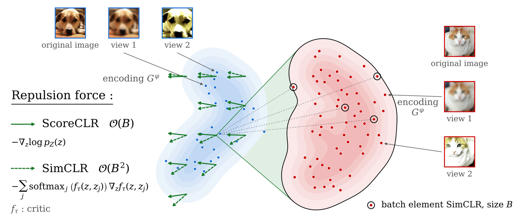

# ScoreCLR

PyTorch implementation of ScoreCLR, self-supervised representation learning where the contrastive
repulsion is replaced by a learned score, together with the baselines of the paper (SimCLR, LeJEPA, BYOL
and Barlow Twins). All methods share the encoder, the data pipeline, the training loop and the
evaluation, and differ only in their objective.

<p align="center">
  
</p>

*Repulsion force acting on a latent code `z`. SimCLR (dashed) estimates it against the `B` codes of the
batch, at a cost `O(B²)`; ScoreCLR (solid) uses the score `−∇ log p(z)` of the latent distribution,
learned by a small network, at a cost `O(B)`.*

## Method

ScoreCLR alternates two updates on the codes `z` of two augmented views:

1. **Score net**: denoising score matching on the detached codes, `‖ε̂(z_t, σ) − ε‖²` with
   `z_t = z + σε` and `ln σ ~ N(p_mean, p_std²)`.
2. **Encoder**: `attr_weight · ‖z₀ − z₁‖²  +  ½‖s(z_t)‖²  +  ½‖z_t‖²` against the frozen score
   `s = −ε̂/σ`. The middle term (ScoreReg in the paper) pushes codes towards lower density; with the
   Gaussian prior term it estimates `KL(Z ‖ N(0, I))`.

## Usage

```bash
pip install -e ".[test]"

# train (CIFAR-10 downloads to data.root); any config key can be overridden on the command line
python -m scoreclr.train --config config/cifar10_scoreclr.yaml data.root=./datasets

# multi-GPU (DDP), batch_size is per GPU
torchrun --nproc_per_node=2 -m scoreclr.train --config config/imagenet100_scoreclr.yaml \
    data.train_path=/path/to/imagenet100/train data.val_path=/path/to/imagenet100/val

# evaluate: linear probe, kNN, geometry, rank, transfer -> <run>/evaluation.json
python -m scoreclr.evaluation --run runs/cifar10_scoreclr --root stl10=./datasets --root dtd=./datasets

pytest
```

`config/` has one file per row of the paper's tables, `src/scoreclr/methods/` one file per method, and
`analysis/` the Poincaré-constant estimate and the cost benchmarks. Training resumes from
`<output_dir>/last.pt`.

## Results

ResNet-18, shared AdamW recipe (gradient clip 1.0, 2048/256 projector without BatchNorm). Mean ± std over
seeds 1, 2 and 3; SimCLR (LARS) rows are single runs (seed 5).

| row (`config/<row>.yaml`) | linear top-1 | kNN top-1 |
|---|---|---|
| `cifar10_scoreclr` | 88.87 ± 0.44 | 88.27 ± 0.13 |
| `cifar10_simclr_adamw` | 89.26 ± 0.38 | 88.73 ± 0.18 |
| `cifar10_lejepa` | 89.67 ± 0.13 | 88.40 ± 0.13 |
| `cifar10_byol` | 88.96 ± 0.30 | 88.44 ± 0.22 |
| `cifar10_barlow` | 88.05 ± 0.15 | 87.17 ± 0.09 |
| `cifar10_simclr_lars` | 90.79 | 89.99 |
| `imagenet100_scoreclr` | 71.23 ± 0.06 | 66.05 ± 0.39 |
| `imagenet100_simclr_adamw` | 72.39 ± 0.62 | 66.41 ± 0.44 |
| `imagenet100_simclr_lars` | 75.40 | 69.98 |
| `imagenet100_simclr_lars_proj4096` | 77.02 | 71.60 |

## Reproducing the paper

```bash
pip install -r requirements-paper.txt --extra-index-url https://download.pytorch.org/whl/cu121 && pip install -e .
python scripts/make_imagenet100.py /path/to/imagenet /path/to/imagenet100     # ImageNet-100 split
DATA=./datasets IMAGENET100=/path/to/imagenet100 bash scripts/reproduce_paper.sh  # all rows
bash scripts/reproduce_paper.sh cifar10_scoreclr                                  # or a single row
```

This trains and evaluates each row and prints the tables next to the paper's numbers
(`python -m scoreclr.evaluation.report runs` prints the tables alone). Pass `seed=<n>` to change the seed.
The paper's SimCLR (LARS) rows were trained with solo-learn itself; the `*_simclr_lars` configs
re-implement that recipe here.

## Licence

MIT (see `LICENSE`), except `src/scoreclr/methods/lejepa.py`, which adapts LeJEPA's reference SIGReg
implementation (https://github.com/rbalestr-lab/lejepa) and is therefore under CC BY-NC 4.0
(non-commercial use only). Files ported from solo-learn (https://github.com/vturrisi/solo-learn, MIT)
keep its copyright notice.
